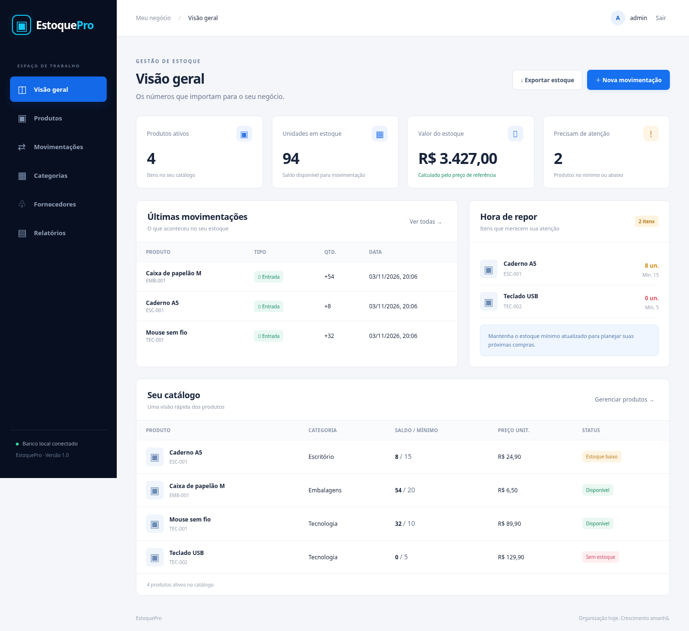

# EstoquePro
Sistema de Gerenciamento de Estoque

Projeto e Engenharia de Software · A3 · 2026/2

Integrantes, instituição, professor e turma: preencher com dados reais.

---

# Problema e justificativa

- Registros dispersos dificultam acompanhar disponibilidade e reposição.
- Alterações de saldo precisam de uma explicação rastreável.
- Um fluxo simples permite centralizar o catálogo e aplicar regras verificáveis.

Não foram realizadas entrevistas de campo; o problema é a premissa do projeto.

---

# Objetivo e público-alvo

Organizar o estoque de pequenos negócios, com um administrador local.

Cadastrar → movimentar → acompanhar → repor → exportar.

Foco em clareza e integridade, com execução reproduzível.

---

# Funcionalidades implementadas

- Autenticação e sessão.
- Categorias, fornecedores e produtos.
- Edição cadastral e arquivamento com histórico preservado.
- Entradas e saídas validadas.
- Painel, alertas, busca e relatório CSV.

---

# Requisitos e regras

12 requisitos funcionais e 12 não funcionais documentados.

Código único; preço em centavos; quantidade inteira; saldo não negativo; motivo obrigatório; saldo/evento na mesma transação.

Exemplo: tentar retirar 6 unidades de um saldo 5 exibe erro e preserva o saldo 5.

---

# Modelagem

Casos de uso, classes reais, sequência, atividades, componentes e DER.

Consultar fontes e imagens em `docs/diagramas/`.

Categoria 1:N Produto; Fornecedor opcional 1:N Produto; Produto 1:N Movimentação; Usuário 1:N Movimentação.

---

# Tecnologias e arquitetura

Navegador (HTML/CSS/JS) → HTTP Python → Inventory → SQLite.

Sem dependências externas obrigatórias. Testes com unittest e, opcionalmente, Playwright.

SQLite usa chaves estrangeiras e transação imediata na movimentação.

---

# Interface

---

# Demonstração prática

1. Entrar no modo demonstração.
2. Criar categoria e produto.
3. Registrar entrada de 5 unidades.
4. Tentar saída de 6: erro e saldo preservado.
5. Registrar saída de 3: saldo final 2.
6. Ver histórico e alerta; exportar CSV.

---

# Testes e qualidade

20 testes automatizados de domínio/API aprovados nesta validação.

Fluxo Playwright aprovado em Chromium: cadastros, edição, busca, movimentações válidas e inválidas, arquivamento, CSV, sessão e logout.

Ver evidências e limitações em `docs/testes/resultado.md`. Não houve auditoria de segurança ou teste de carga completo.

---

# Dificuldades e soluções

- Concorrência → transação antes da leitura do saldo.
- Rótulos de seletores → nomes acessíveis explícitos e teste repetido.
- Reprodução → Python padrão, dados demo idempotentes e testes isolados.
- PDF e template ausentes → documentação provisória com pendências identificadas.

---

# Conclusão e próximos passos

Ciclo de estoque implementado e validado localmente.

Próximas ações: receber PDF e template, revisar com integrantes, incorporar a marca original como arquivo e ensaiar a apresentação.

Entrega acadêmica, push e publicação ainda não realizados.
