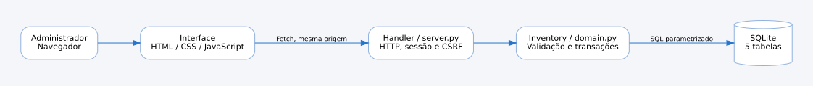
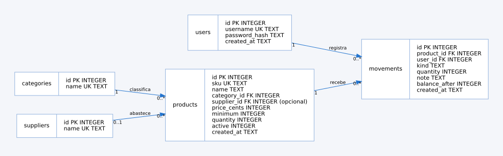

# Diagramas do MVP

| Diagrama | Fonte | Visual estático |
|---|---|---|
| Casos de uso | [PlantUML](casos-de-uso.puml), [Graphviz](casos-de-uso.dot) | [SVG](casos-de-uso.svg) |
| Classes da implementação | [Mermaid](classes.mmd), [Graphviz](classes.dot) | [SVG](classes.svg) |
| DER lógico | [Mermaid](der.mmd), [Graphviz](der.dot) | [SVG](der.svg) |
| Componentes | [Mermaid](componentes.mmd), [Graphviz](componentes.dot) | [SVG](componentes.svg) |
| Sequência de saída | [Mermaid](sequencia.mmd) | Renderizar em visualizador Mermaid |
| Atividades de movimentação | [Mermaid](atividades.mmd) | Renderizar em visualizador Mermaid |

As versões Graphviz são representações equivalentes preparadas para gerar visuais offline com a ferramenta disponível. Elas não são conversão automática dos arquivos Mermaid/PlantUML; manter ambas coerentes ao alterar o modelo. Para regenerar um visual com Graphviz instalado, na raiz:

```bash
dot -Tsvg docs/diagramas/der.dot -o docs/diagramas/der.svg
```

Repetir para classes, componentes e casos-de-uso. Abrir o SVG em navegador ou inserir em documento compatível. `classes` representa classes reais de Python; `der` representa entidades relacionais. A ausência de classes de entidade próprias é intencional e explicada na documentação técnica.




